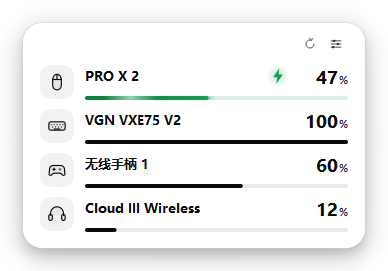
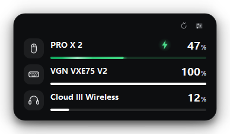
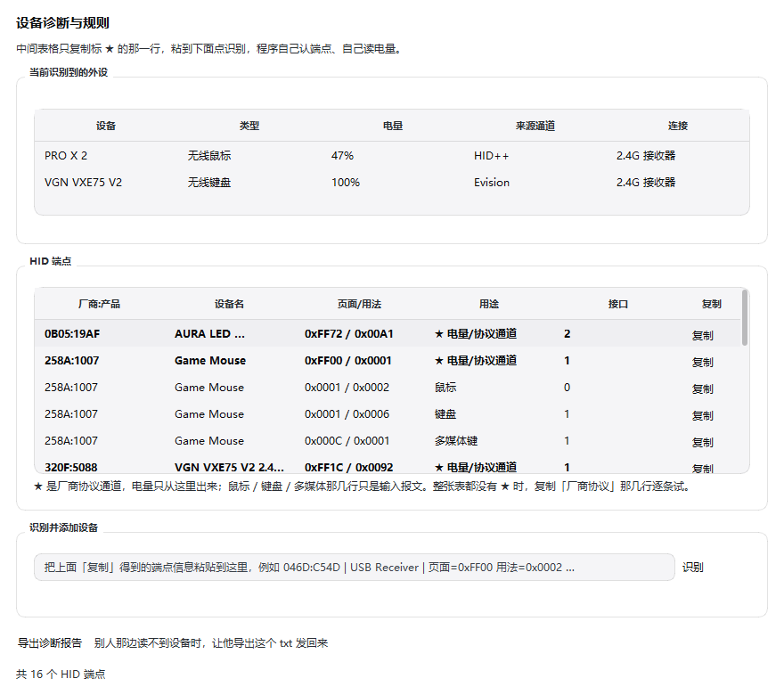

# 外设电量 · WirelessBattery

> Windows 托盘小工具：实时显示 2.4G 无线键鼠耳机的电量，充电时托盘图标会「涨满」。
> A lightweight Windows tray app that shows the battery level of your 2.4 GHz wireless peripherals in real time.


[](https://github.com/LargeAkon/WirelessBattery/releases/latest)

---

## 这个项目解决什么问题

罗技有 G HUB，雷蛇有雷云，VGN 有自家的驱动——但你桌上通常不是同一个牌子。
想看一眼「鼠标还剩多少电」，得开三个后台程序；而那些没做驱动的国产品牌，压根没地方看。

这个小工具只做一件事：**在托盘区把电量直接显示出来**——电池内腔填多长就是多少电，
鼠标移上去能看到逐台设备的读数，插上线充电时绿色会从左往右慢慢涨满。
不装驱动、不联网、不驻留后台服务。

---

## 界面

**托盘图标**：电池内腔的填充长度就是剩余电量，充电时绿色从左侧一路涨满。

<p align="center">
  
</p>

**设备卡片**：一屏看完所有在线设备，充电中的设备电量条泛绿。

<p align="center">
  
  
</p>

<p align="center"><sub>左：浅色主题　右：深色主题</sub></p>

设备诊断：列出系统里全部 HID 端点，标明用途，★ 那行才是承载电量的协议通道。
点「复制」→ 粘贴 → 「识别」，程序自己认端点、自己读电量。

<p align="center">
  
</p>

---

## 功能

- **托盘常驻**：电池图标内腔的填充长度跟着电量走，插电时左侧绿色逐帧涨满，一眼可见。
- **多设备同屏**：鼠标、键盘、耳机同时列出，各自独立电量条。
- **设备休眠不消失**：接收器断连时保留上次读数并标注「信号中断」，不会一闪一闪地跳没。
- **三种刷新档位**：10 / 15 / 20 分钟；检测到充电时自动加密到 30 秒一次。
- **开机自启**：写 HKCU 注册表，无需管理员权限，卸载时自动清理。
- **设备诊断**：列出系统里全部 HID 端点，标明每个端点是什么用途，一键复制、一键识别。
- **纯本地运行**：不联网、不上报、不收集任何数据。

---

## 支持的设备

2.4G 无线**没有统一的电量标准**。蓝牙有标准 GATT 电池服务，2.4G 则各家一份私有报文。
所以这里的做法不是「读一个通用接口」，而是**按无线方案商逐个实现协议**——
一个品牌一个品牌去猜是没尽头的，但方案商只有十来家。

| 通道 | 覆盖范围 | 状态 |
|---|---|---|
| **HID++ 2.0** | 罗技全系（G Pro / GPW / MX Master / G913 等） | 已实现 |
| **Evision** | VGN、ATK 全系（`VID 320F`） | 已实现 |
| **HyperX** | HyperX 2.4G 耳机（按产品号匹配） | 已实现 |
| **Compx** | 中颖 / 万灵公版方案，多家贴牌键鼠共用 | 已实现 |
| **厂商 0x83 特征报告** | 用 Feature Report 0x83 回电量的公版方案 | 已实现 |
| **Razer** | 雷蛇（`0x07` / `0x80` 查询帧） | 已实现 |
| **ASUS** | 华硕 ROG 系（`12 07` 帧） | 已实现 |
| **Rapoo** | 雷柏（主动上报，被动监听） | 已实现 |
| **VAXEE** | VAXEE 无线鼠标 | 已实现 |
| **怒喵 / Ajazz** | 怒喵、黑爵同方案 | 已实现 |
| **XInput** | Xbox 手柄（四档电量） | 已实现 |
| **HID 标准电池集合** | 遵守 HID Usage Page 0x06 `Battery Strength` 的设备 | 已实现 |
| **Windows 电池类设备** | 系统为其注册了电池设备的外设（只读 IOCTL） | 已实现 |
| **Windows 设备属性** | 系统能报告 BatteryLevel 属性的设备 | 已实现 |
| **自定义规则** | 你在诊断窗口里现场识别出的私有格式，自动存成规则 | 已实现 |

> **读不到就不显示。** 宁可列表里少一行，也不会给你一个假的百分比——
> 这是这个项目最硬的一条规则。

**明确不支持的**：蓝牙设备（本项目只处理 2.4G 与 USB 有线）；
无电量接口的公版接收器（例如 `258A:1007` 中颖方案，固件里根本没有电量字段）；
以及尚未实现协议的品牌——这类设备请走下面的「帮我适配」流程。

---

## 安装

### 方式一：安装包（推荐）

到 [Releases](https://github.com/LargeAkon/WirelessBattery/releases/latest) 下载 `WirelessBatterySetup.exe`，双击安装。
可选安装路径、创建快捷方式、开机自启，自带卸载程序。约 45 MB，已内置 Qt 运行时，不需要装 Python。

### 方式二：从源码运行

```bash
git clone https://github.com/LargeAkon/WirelessBattery.git
cd WirelessBattery

python -m pip install -r requirements.txt

cd app
python main.py
```

需要 Python 3.10+ 与 Windows 10/11。托盘运行（不弹窗口）用 `python main.py --tray`。

---

## 使用

安装后程序常驻托盘，**左键点图标**弹出设备卡片，**右键**是菜单：

| 菜单项 | 作用 |
|---|---|
| 立即刷新 | 跳过冷却，强制重读所有通道 |
| 打开设置 | 刷新间隔、主题、毛玻璃、自启动 |
| 开机自启动 | 勾选即写注册表 |
| 设备诊断 | 端点列表 + 复制识别 + 导出报告 |
| 退出 | 完全退出 |

卡片上每台设备显示：图标、名称、电量条、连接方式。点击设备可以改类型和显示名（识别错名字时用）。

---

## 工作原理

程序把「找电量」拆成九条互不依赖的通道，并行跑一遍，再合并去重：

```
                    ┌─ Evision ──────── VGN / ATK
                    ├─ HID++ ───────── 罗技
                    ├─ HyperX ──────── HyperX 耳机
   HID 端点枚举 ────┼─ 芯片组 ───────── Compx / Razer / 华硕 / 雷柏 / VAXEE / 怒喵 / 手柄
   （一次，共享）    ├─ HID 描述符 ───── 标准 Battery Strength
                    ├─ 系统电池 ─────── GUID_DEVCLASS_BATTERY（只读 IOCTL）
                    ├─ 系统属性 ─────── DEVPKEY 电量属性
                    └─ 自定义规则 ───── 你自己识别出来的格式
                                    ↓
                          合并去重（VID:PID + 设备类型）
                                    ↓
                            统一设备列表 → 托盘 / 卡片
```

几个关键设计：

- **只读**。所有查询都是「问一句电量」，不写配置、不改灯效、不碰固件。
  唯一会写的是「自定义规则」里你自己填的查询帧。
- **同帧交叉验证**。读到百分比后，会核对同一帧里的状态字段（如 `levelStatus`、`chargingStatus`），
  对不上就丢弃。曾经出现过把 `0x0C` 当成「15 级里的第 12 级」算出 80%、
  而设备实际已经亮红灯的情况——现在这类错读会在校验环节被拦住。
- **跨通道去重**。同一只接收器会被多个通道同时命中，按 `VID:PID + 设备类型` 合并，
  而不是按名字。接收器上的键盘不会因为鼠标被读到就被一起删掉。
- **缓存分级**。HID++ 设备休眠后握手不应答是常态，所以读到过的端点缓存 10 分钟，
  其他厂商 5 分钟，系统通道 3 分钟。连续失败 3 次且超过保留时长才从列表移除。
- **不猜**。帧长度、校验、上报格式任一对不上，就跳过，不产生读数。

---

## 帮我适配新设备

这是最需要的贡献方式。你手上有一台读不到电量的设备时：

1. 右键托盘 → **设备诊断**
2. 中间表格会列出系统里全部 HID 端点，每行右侧有「复制」按钮
3. 找到标 **★** 的那行（厂商协议通道，页面 `0xFF00`），点「复制」
4. 内容会自动填入下方输入框，点 **识别**
5. 如果识别失败，点最下方 **导出诊断报告**，把生成的 txt 发到 Issues

报告里每个端点都标注了所属方案商，例如 `0C45 → Sonix 松翰公版`。
有了这份报告，就能判断该补哪家协议，而不是靠型号瞎猜。

> 为什么需要报告：私有协议必须对着真实设备的应答帧写解析器。
> 没有报文样本，凭空写出来的解析器一定会读错。

---

## 构建安装包

```bash
python -m pip install -r requirements.txt
python build.py
```

流程：PyInstaller 打出程序本体 → 压缩成 `payload.tar.xz` → 内嵌进单文件安装向导 →
输出 `dist/WirelessBatterySetup.exe`（约 45 MB，含 Qt 运行时）。

---

## 目录结构

```
app/
  main.py            托盘、菜单、刷新调度、充电动画
  scanner.py         九通道并行调度 + 合并去重 + 失败缓存
  model.py           Device 数据模型
  config.py          配置持久化（%APPDATA%）与开机自启
  theme.py           配色与样式表
  recognize.py       「复制端点 → 粘贴识别」的解析与探测
  vendors.py         VID → 无线方案商对照表
  providers/         各条电量通道，一个文件一套协议
  ui/                卡片窗口、诊断窗口、毛玻璃、图标绘制
installer/setup.py   安装向导（打包成单文件 Setup.exe）
build.py             一键构建
tools/               开发期探针与冒烟脚本（不参与打包）
```

---

## 已知限制

- **仅 Windows**。深度依赖 `hidapi`、`setupapi`、`winreg`，没有跨平台计划。
- **仅 2.4G 与 USB 有线**。蓝牙设备不探测、不显示。
- **部分设备注定读不到**。厂商没做电量上报、或私有协议未公开且无样本的设备，
  在补协议之前不会有读数。这类情况会明确不显示，而不是显示 `--`。
- **未实现协议的通道占用时间**。`oem.py` 对每台接收器串行跑 8 个探针，
  本机没有对应设备时约 2.4 秒，是当前一次刷新（约 2.6 秒）的主要耗时来源。
- **不能保证每个品牌都覆盖**。这是按方案商适配的项目，覆盖面随 Issues 里的报告增长。

---

## 隐私

- 不联网。程序没有任何 HTTP 请求，没有更新检查，没有统计上报。
- 配置只存在本机 `%APPDATA%\WirelessBattery\config.json`。
- 诊断报告只在**你主动点击**时生成到桌面，内容是本机 HID 端点列表，不会自动发送。
- 卸载时删除安装目录与自启项；`config.json` 会保留，需要时手动删。

---

## 贡献

欢迎提 Issue，尤其是**带诊断报告的「读不到电量」反馈**——这是这个项目最主要的信息来源。
提交代码前请保持两条原则：查询一律只读；读不准宁可不读。

---

## License

[MIT](LICENSE) © 2026 Akon
