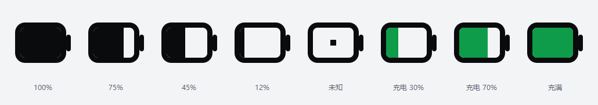

<div align="center">

<h1>外设电量 · WirelessBattery</h1>

<p>Windows 托盘小工具：一屏看完 <b>2.4G 无线键盘、鼠标、手柄、耳机</b> 的电量。</p>

<p>


</p>

<p>
<a href="https://github.com/LargeAkon/WirelessBattery/releases/latest"></a>
</p>

<p>
<a href="#界面">界面</a> ·
<a href="#支持设备">支持设备</a> ·
<a href="#安装">安装</a> ·
<a href="#使用">使用</a> ·
<a href="#适配新设备">适配新设备</a> ·
<a href="#开发">开发</a>
</p>

</div>

---

## 界面

<div align="center">
  
  <br><sub>托盘图标：电池内腔填多长，就是还剩多少电；充电时绿色从左往右涨满</sub>
</div>

<div align="center">
  
  
  <br><sub>设备卡片：左键点托盘图标弹出，所有在线设备一屏看完</sub>
</div>

---

## 功能

| 能力 | 说明 |
|---|---|
| **托盘读数** | 电池图标内腔的填充长度跟着电量走，插电时逐帧涨满，不点开也能看见 |
| **悬停即看** | 鼠标停在托盘图标上就弹出卡片，不用点；点开的那张才钉住不跟着鼠标走 |
| **多设备同屏** | 键鼠、手柄、耳机同时列出，各自独立电量条，标注连接方式 |
| **休眠不丢** | 设备断连时保留上次读数并标「信号中断」，不会一闪一闪地跳没 |
| **刷新策略** | 常规 10 / 15 / 20 分钟；检测到充电自动加密到 30 秒 |
| **换肤动效** | 深浅色与毛玻璃切换都是圆形揭开：新皮肤从点中的那个选项扩散铺满 |
| **一键诊断** | 点一下跑完全部协议通道，列出端点清单，读不到的设备写明原因 |
| **手动添加** | 诊断页「添加设备」：选接收器 → 选品牌型号（可搜索）→ 试读 → 添加，存成外置协议 |
| **协议库** | 内置 57 条厂商协议 / 28 个品牌组，供「添加设备」选型号试读，通过后随刷新读取 |
| **开机自启** | 写 HKCU 注册表，无需管理员权限，卸载时自动清理 |

---

## 支持设备

2.4G 没有统一的电量标准——蓝牙有 GATT 电池服务，2.4G 各家一份私有报文。
所以这里不读「通用接口」，而是**按无线方案商逐个实现协议**：品牌几百个，方案商只有十来家。

| 方案商 / 通道 | 覆盖 |
|---|---|
| **HID++ 2.0** | 罗技全系：G Pro、GPW、MX Master、G913 等 |
| **Evision** | ATK、VGN、VXE、WOBKEY 的键鼠（`VID 320F`，`FF1C:0092`）；WOB 系（Rainy75 / Wave75）回包慢，最长等 14 秒 |
| **Compx 17 字节帧** | 页面 `FF02` 的接收器，不看品牌：ATK、VXE、VGN 鼠标、达尔优、Pulsar、Attack Shark、狼蛛键盘、Ninjutso、因科特、Hitscan、塞洛斯、Finalmouse、赴极等贴牌 |
| **Nordic 54** | ATK Zero 一类（`VID 373B`，页面 `FF05`） |
| **0x83 特征报告** | 万灵花兽、兰族、G-Wolves、迈从；中颖公版上的狼蛛、前行者、部分黑爵与多彩 |
| **迈从 G7** | `VID A8A5` 的 `AA 30` 应答 |
| **Razer** | 雷蛇（`0x07` / `0x80` 查询帧） |
| **ASUS** | 华硕 ROG / TUF（`12 07` / `12 01`） |
| **VAXEE** | VAXEE 无线鼠标 |
| **怒喵 / 黑爵 / Akko** | 同一套状态报告 `0x05`（`VID 3151`） |
| **赛睿** | Arctis Nova 7 Gen2 的 `b0`、Aerox 的 `d2`、Rival 3 的 `aa` |
| **飞智** | Vader 5 Pro 的 GET_INFO（`VID 37D7`）；旧款只有系统四档，不折算 |
| **HyperX** | HyperX 2.4G 耳机（按产品号匹配）；含 Cloud III Wireless `03F0:05B7`，命令走控制管道 |
| **雷柏 / JBL** | 接收器主动上报，被动监听 |
| **八位堂 / 索尼** | DualShock 4 与八位堂手柄的输入报告（DualSense 只有蓝牙/有线，不做） |
| **协议包（逐型号私有协议）** | 见下表，按接口指纹 + 报文校验双重判定 |
| **已添加协议** | 「添加设备」里手动试读通过的型号，存成外置协议后随刷新读取 |

表中除「雷柏 / JBL / 八位堂 / 索尼」是设备主动上报外，其余都是程序主动发一帧查询。

> **列表里少一行，也不给假数字。**
> 解析不出确切百分比就不列出该设备，不显示 `--`，也不猜一个值。

**协议库覆盖**

| 品牌 | 型号 |
|---|---|
| VXE | V3 NK / R1 Nearlink、R1 Pro Max / R1 SE |
| ATK | F1 Pro Max / F1 V3 / F1 Ultimate、F1 Moba F503、A9 Air 大师+、Z87 系键盘、A87 Pro、V75X、N9V2 Ultimate 耳机、Nordic 54 鼠标 |
| VGN | 北影键盘、蜻蜓 Dragonfly3 SE、F1 Pro（4K）、F2 大师+、F1 V5 Turbo+、V98 Pro、ryMs 接收器（3 Pro Max / Y2 V2 Pro Max / F1 V2 Pro Max / 3 Ultra / F1 V5 Ultra / F2 V2 Ultra） |
| 迈丛 MCHOSE | G75 Pro / Z75S / K99 / GX87 / G75 键盘、A7 V3 Pro / Ultra+、V9 Turbo+ 耳机、G7 |
| 凌豹 Lingbao | K98 键盘、M1 Pro、M5PRO Max |
| 狼蛛 AULA | F99 Pro、F108 Pro |
| LEOBOG | Hi75c Pro、HI98PRO |
| 钛度 / IMECOO | TSG809、HJSDZHI S1-V2、P1 |
| 华硕 ROG | AZOTH 系 Omni 键盘、HARPE / KERIS Omni、Keris AimPoint、SPEEDNOVA 8K、PELTA / DELTA II 耳机 |
| HyperX | Cloud II Wireless、Cloud III / II Core、Cloud III S（`03F0:02CC`）、Alpha 2、Alpha Wireless |
| 漫步者 HECATE | G3M Pro、G5M Pro |
| 其他 | 达尔优 A950 AIR V2、西伯利亚 T7 / T7 GT、Pulsar X2 / Link 8K、Scyrox 8K、Hitscan Hyperlight、CROCIRIS X7、CHERRY MX 2.0S WL Pro、水月雨 GM01 Pro、高斯 GS3104T-Pro、寸渊影弑 SHADOW、前行者 S9 PRO、多彩 GH8K / M900 Ultra、北通 KP40D、VAXEE / ZYGEN |

**协议包覆盖**

这些型号的帧格式都来自官方软件抓包或公开逆向文档，逐条带校验；能被动听的绝不发帧。
只做 2.4G 接收器与 USB 有线，蓝牙链路一律不接。

| 品牌 | 型号 | VID:PID | 判据与帧 | 状态 |
|---|---|---|---|---|
| 派世 PULSAR | X2 V2 | `3554:F508` | 17 字节 STATUS/POWER，校验 `0x55 - sum` | 原项目本机验证 |
| CHERRY | PIXIU75 | `046A:01E4` / `01E2` | 64 字节块协议，块 `0x1A` 读电量 | 原项目真机 |
| 华硕 ROG | Strix Scope II 96（Omni 接收器） | `0B05:1ACE` | 先 `A0` 核对配对表，再 `12 01` 读电量 | 原项目真机 95% |
| 华硕 ROG | 无线耳机 | `0B05:1AFA` | `0xCC` 帧 `12 07` 电量、`12 08` 充电 | 原项目真机 |
| 英菲克 | ZHEN | `1D57:FA65` | 被动 `0x03` 帧（`76 41`） | 原项目真机 |
| DELUX | M900 Pro | `1D57:FA65` | 被动 `0x03` 帧（`30 40`） | 原项目真机 |
| HECATE | G5M Pro | `35BB:D00B` | `0x04` 帧（`1A` 标记）+ 一条查询 | 原项目真机 |
| 盖世小鸡 | G7 Pro CE | `3537:*` | `0x12` 状态流 + `0F F2 00` 心跳 | 原项目真机 |
| 黑爵 AJAZZ | AK870 | `3151:4011` | feature `F7 08` 邮箱查询 | 原项目真机 |
| 凌豹 LINGBAO | M5PRO Max | `3151:402D` | feature `F7` 状态查询 | 原项目真机 |
| 凌豹 LINGBAO | K98 | `3554:FA09` | `0x13` 会话/推送，型号密码 `0x0212` 分流 | 贡献者真机 |
| 雷神 THUNDEROBOT | ML903 NearLink Se | `369B:0234` | `A0 02` TLV（标签 `0x0225` 是电量） | 原项目真机 |
| 前行者 EWEADN | X87 键盘 | `0C45:FEFE` | 33 字节帧，校验在 `[32]` | 原项目真机 |
| 前行者 EWEADN | S9 鼠标 | `372E:1026` | feature `0x03` 的 BASICS 邮箱 | 原项目真机 |
| 雷柏 RAPOO | VT3 二代 | `24AE:*` | 被动 report `0x07` 状态帧 | 原项目本机验证 |
| 墨将 MOJHON | 烈风 2 GALE2 | `E2B7:122C` | `A4` 寄存器 `0x04` 读写，末位校验 | 原项目真机 |
| AKG | N9 Hybrid | `0ECB:20D9` | 接收器 RACE 电量查询 | 贡献者真机 50% |
| 寸渊影弑 | SHADOW | `3654:6901` | `FE` 魔数 GetBasicInfo，`0x80` 是充电位 | 原项目真机 |
| GANSS / 狼蛛 | GS3104T-Pro / F108 Pro | `05AC:024F` | 33 字节查询帧（两型号同指纹，共用一行开关） | 贡献者真机 |
| 北通 BETOP | T9 / 鲲鹏 20 | `20BC` / `20DD` | 2.4G 广播被动帧 + 有线查询 | T9 本机，鲲鹏 20 贡献者 |
| 狼蛛 AULA | F99 Pro | `3554:FA09` | `0x13` 会话 + `0x0A` 推送 / `0x4A` 应答 | 贡献者真机 |
| 狼蛛 AULA | G9 耳机 | `38A6:0030` | 被动 `0xAB` 状态帧 | 贡献者声明 |
| 狼蛛 AULA | L9 Ultra 鼠标 | `38A6:28FD` | `0x81` 查询，电量/充电在 `[17]/[18]` | 贡献者声明 |
| 狼蛛 AULA | HERO 68 Air | `372E:106C` | 8K 接收器 Bytech 分片查询 | 贡献者真机 |
| VGN | 蜻蜓 F1 V5 Turbo+ / F2 大师+ | `391D:1A23` / `1026` | kc2 配置帧（`0xB3/0x06`），`0x80` 是充电位 | 贡献者真机 |
| VGN | Y2 | `3554:FB56` / `FB57` | `0x08/0x04` 查询 | 贡献者真机 |
| VGN | V98 Pro | `320F:*` | `0x1A` 查询，插线后按序列号只留一条接口 | 贡献者真机 |
| ATK / VXE | 无线鼠标 / A98 Pro | `373B:*` | 17 字节查询帧（鼠标）/ VIA（键盘） | 鼠标两条真机 |
| 雷蛇 RAZER | 毒蝰 V4 Pro | `1532:00E6` / `00E5` | 经典 90 字节 feature（`0x07/0x80`、`0x84` 充电） | 原项目本机验证 |
| 雷蛇 RAZER | Viper V3 Pro SE | `1532:00DF` | 电量查询专用帧 | 原项目本机验证 |
| 雷蛇 RAZER | BlackShark V2 Pro (2023) | `1532:0555` | PA 远程模式：`0x21` 电量、`0x2A` 充电 | 原项目本机验证 79% |
| 雷蛇 RAZER | Kraken V4 | `1532:056C` | 64 字节 `0x02` 查询 | 贡献者声明 |
| 迈从 MCHOSE | G87 / G87 V2 / K99 / X75 系 | `3837` / `41E4` | `0x13` 会话 ACK + `0x0A` 推送，bit4 充电 | 本机 G87 V1 |
| 迈从 MCHOSE | G87 V2 / A7 V2 Pro | `3837` / `41E4` | 鼠标 V2 被动 `0xE2` 反码帧 | 贡献者真机 |
| 迈从 MCHOSE | K7 V2 Ultra+ | `3837:1018` | `0x0900` 查询 + `0x0600` 事件 | 贡献者真机 |
| 迈从 MCHOSE | G3 V2 | `3837:4245` | Gmouse 主动查询（`55 30 A5…`） | 贡献者真机 |
| 迈从 MCHOSE | A5 V2 Ultra | `3837:100C` | 反码 feature `0x11` | 贡献者声明 |
| 迈从 MCHOSE | V9 Pro / X9 耳机 | `291D:385D` / `3837:6045` | 64 字节 `55 65 01` 查询 | V9 真机，X9 声明 |
| 迈从 MCHOSE | G75 Pro | `3554:FA09` | 与狼蛛 F99 Pro 同指纹，靠会话 ACK 型号分流 | 贡献者真机 |
| 迈从 MCHOSE | 新代 QHW dongle | 如 `3837:3033` | `0x4D` 握手 → `0x0904` 查询 / CZ 推送 | 待对应设备验证 |
| 索尼 SONY | INZONE H9 II | `054C:0FA8` | `0xFF04` 控制传输查询（必须走 SET_REPORT） | 原项目本机验证 |
| Haute42 | Adapter 4DS | `054C:0CE6` | 只读 feature `0xF9`，靠固件串认适配器 | 贡献者声明 |
| HyperX | Cloud Flight 2 | `03F0:0AC1` | 被动 `0xFB` 事件帧（`0x13` 电量） | 原项目真机 |

双向口径：表里"原项目"指 vigil-watt 的实机结论，我这边的每一条解码都用它的单元测试报文做过回归
（`tools/test_packs.py`，178 项）。**会写帧的家族**（雷蛇、迈从、K7、A5、AKG、GANSS、ATK/VGN、北通、
华硕、CHERRY、雷神、凌豹、墨将、前行者、HECATE、索尼、Haute42）默认每轮只发一条查询，失败进 150 秒冷却。

协议代码按 **鼠标 / 键盘 / 耳机 / 手柄** 分目录，一个品牌一个文件；品牌跨类型时会在多个目录下出现同名文件
（`mouse/vgn.py` 管蜻蜓鼠标，`keyboard/vgn.py` 管 V98 Pro）。想自己加一台设备，看
[`app/providers/packs/README.md`](app/providers/packs/README.md)：三步流程、模板代码、判据表都写在里面。

**暂不支持**

| 情况 | 原因 |
|---|---|
| 蓝牙设备 | 只处理 2.4G 与 USB 有线 |
| 无电量接口的公版接收器（如 `258A:1007`） | 固件里没有电量字段 |
| 任天堂手柄 | USB / 蓝牙，不走 2.4G 接收器 |
| Xbox 手柄 | 系统只给四档（5 / 25 / 60 / 100），不拿档位折算成百分比 |
| Lofree、IPI、EPOS 等 | 私有帧还没有样本，可用诊断页「添加设备 → 自动探测」尝试 |
| 其余未覆盖品牌 | 按方案商适配，覆盖面随 Issues 里的报告增长 |

---

## 安装

**安装包**：到 [Releases](https://github.com/LargeAkon/WirelessBattery/releases/latest) 下载 `WirelessBatterySetup.exe`，双击安装。
约 43 MB，内置 Qt 运行时，不需要装 Python。可选安装路径、创建快捷方式、开机自启，自带卸载程序。

**从源码运行**：

```bash
git clone https://github.com/LargeAkon/WirelessBattery.git
cd WirelessBattery
python -m pip install -r requirements.txt
cd app && python main.py
```

需要 Python 3.10+ 与 Windows 10 / 11。只想挂在托盘、不弹卡片，用 `python main.py --tray`。

---

## 使用

鼠标停在托盘图标上 → 直接弹出设备卡片；<kbd>左键</kbd> 钉住 / 收起，<kbd>右键</kbd> → 菜单。

| 菜单项 | 作用 |
|---|---|
| 立即刷新 | 跳过冷却，强制重读所有通道 |
| 打开设置 | 刷新间隔、主题、毛玻璃、自启动 |
| 开机自启动 | 勾选即写注册表 |
| 设备诊断 | 一个按钮自动找设备、手动添加、导出报告 |
| 退出 | 完全退出 |

卡片上点设备可以改类型和显示名，识别错名字时用。

---

## 适配新设备

这是最需要的贡献方式。手上有读不到电量的设备时：

1. <kbd>右键</kbd>托盘 → **设备诊断** → **自动查找设备**
2. 还读不到，点右上角 **添加设备**：选中那台接收器，从品牌型号里选自己的设备，点 **试读**
3. 不知道型号就点 **自动探测**，程序会逐条试协议库里的模板，两次读数一致才算命中
4. 仍不行再点 **导出报告**，把桌面上的 txt 发到 [Issues](https://github.com/LargeAkon/WirelessBattery/issues)

报告里每个端点都标注了所属方案商（例如 `0C45 → Sonix 松翰公版`），并附上接收器原始上报帧，据此能判断该补哪家协议，而不是按型号瞎猜。

---

## 开发

```bash
python -m pip install -r requirements.txt
python build.py            # → dist/WirelessBatterySetup.exe
```

流程：PyInstaller 打出程序本体 → 压成 `payload.tar.xz` → 内嵌进单文件安装向导。

```
app/
  main.py       托盘、菜单、刷新调度、充电动画
  trayhover.py  托盘图标悬停 → 弹卡片（轮询光标与图标矩形）
  scanner.py    通道调度 + 合并去重 + 失败缓存
  profiles.py   协议库引擎：按协议发帧、取偏移、校验回包
  profiles_data.py  内置 57 条厂商协议（纯数据）
  autodiag.py   一键诊断：全通道扫描 + 端点清单 + 未读到原因
  brands.py     品牌 VID → 走哪套电量帧
  vendors.py    芯片与系统设备的方案商对照
  providers/    各条电量通道，一个文件一套协议
    registry.py   通道清单与来源规则（谁读、优先级、保留时长、合并权重）
    packs/        逐型号私有协议，按「设备类型 → 品牌 → 型号」组织
      mouse/        鼠标：vgn.py 管蜻蜓 F1/F2，razer.py 管毒蝰
      keyboard/     键盘：vgn.py 管 V98 Pro，cherry.py 管 PIXIU75
      headset/      耳机：sony.py 管 INZONE H9 II，akg.py 管 N9 Hybrid
      gamepad/      手柄：gamesir.py 管 G7 Pro，betop.py 管北通
      README.md     加一台新设备改哪个文件：三步流程 + 模板 + 判据表
    added.py      「添加设备」写进来的外置协议
  ui/           卡片、诊断窗口、换肤动效、毛玻璃、图标绘制
installer/      安装向导（打包成单文件 Setup.exe）
tools/          开发期探针与冒烟脚本（不参与打包）
```

四条原则：

- **只读**：所有查询只问电量，不写配置、不改灯效、不碰固件。
- **不打断打字**：2.4G 键盘的厂商命令和按键报文走同一条空中链路（接收器上
  往往还是同一个 HID 接口的不同 collection），打字中途插帧会把 key-up 挤到
  命令往返之后。所以每次发帧前先确认系统已空闲 0.6 秒，等不到就整轮跳过、
  下轮再读；一轮最多发两帧，确认过哪套写法后就只发那一套。
- **多通道并行**：六条通道共用一次 HID 枚举；清单与优先级集中在 `providers/registry.py`，
  结果按 `VID:PID + 设备类型` 合并去重。
- **读不准就不读**：帧长度、校验、状态字段任一对不上就跳过；不靠猜字节凑百分比。

---

## 隐私

不联网，没有任何 HTTP 请求，没有更新检查和统计上报。配置只存本机 `%APPDATA%\WirelessBattery\config.json`。
诊断报告只在你点击导出时生成到桌面，内容是本机 HID 端点列表，不会自动发送。

---

## License

[MIT](LICENSE) © 2026 Akon
